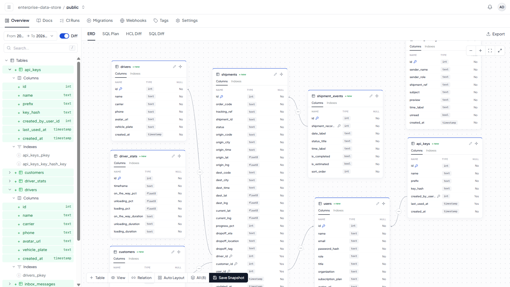
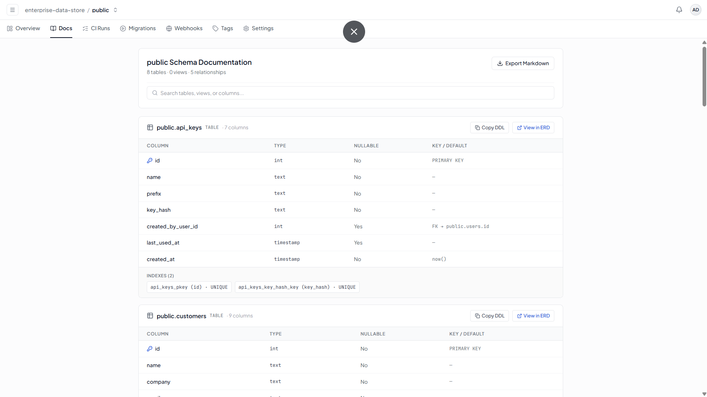
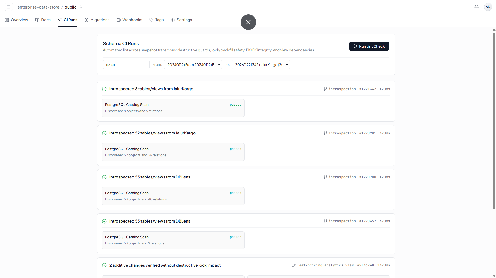
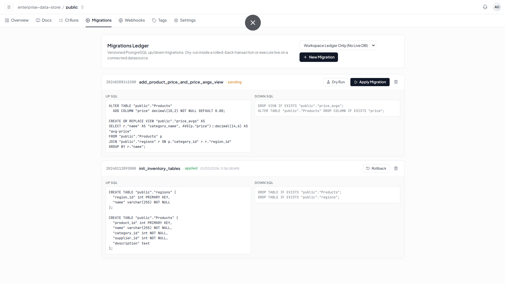
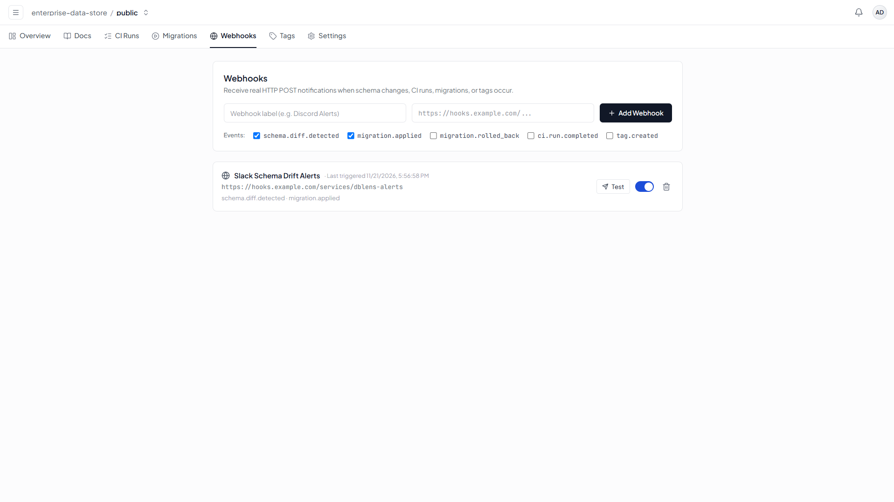
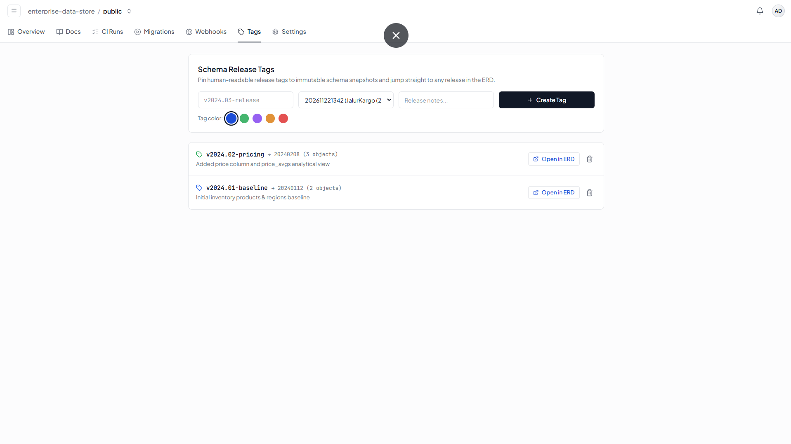
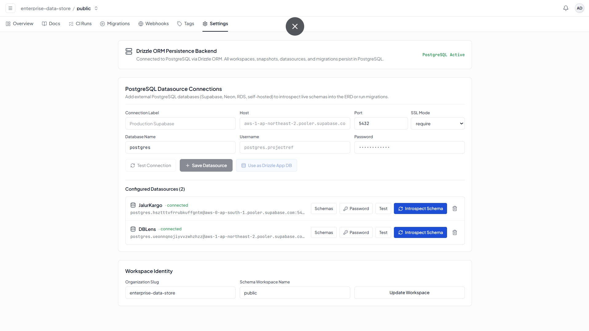
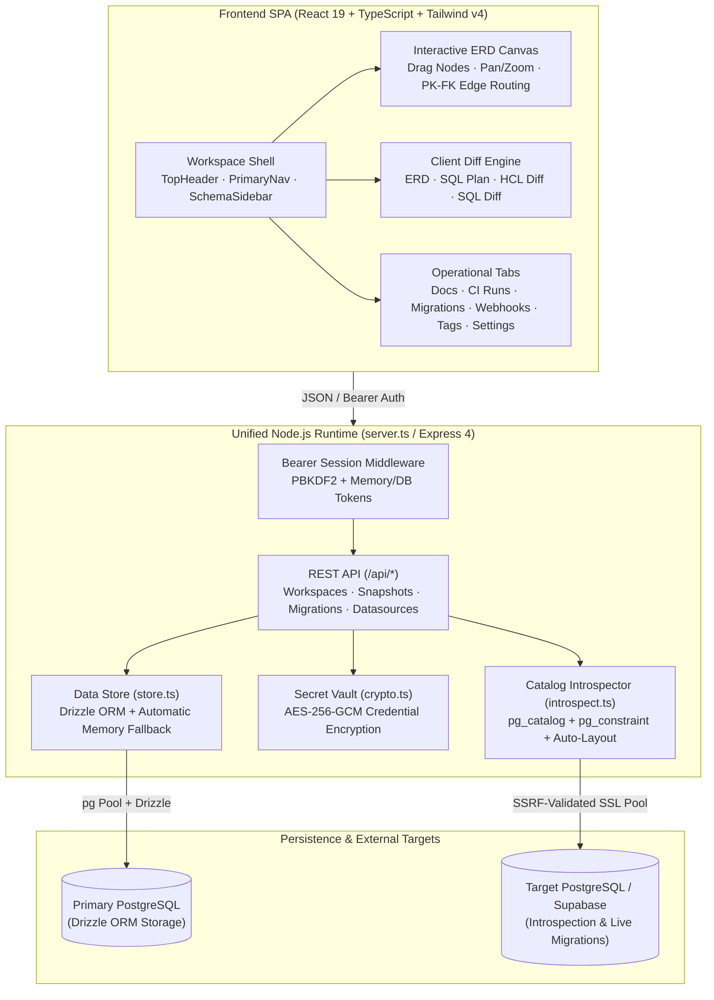

<div align="center">

# DBLens

**Visual PostgreSQL Schema Explorer, Interactive ERD Builder, and SQL/HCL Migration Diff Workspace**

<p>
  
  
  
  
  
  
  
</p>

</div>

---

## Showcase

<p>
  
</p>

<table>
  <tr>
    <td width="33.33%" align="center">
      
      <br />
      <sub><strong>Schema Docs</strong> — Search, Copy DDL, Indexes, ERD jump &amp; Markdown export</sub>
    </td>
    <td width="33.33%" align="center">
      
      <br />
      <sub><strong>CI Runs</strong> — Snapshot transition lint, lock safety &amp; FK/view checks</sub>
    </td>
    <td width="33.33%" align="center">
      
      <br />
      <sub><strong>Migrations</strong> — Manual/diff SQL, live PostgreSQL dry-run, apply &amp; rollback</sub>
    </td>
  </tr>
  <tr>
    <td width="33.33%" align="center">
      
      <br />
      <sub><strong>Webhooks</strong> — Multi-event HTTP POST alerts &amp; live test ping</sub>
    </td>
    <td width="33.33%" align="center">
      
      <br />
      <sub><strong>Release Tags</strong> — Color-coded snapshot pins &amp; one-click Open in ERD</sub>
    </td>
    <td width="33.33%" align="center">
      
      <br />
      <sub><strong>Datasources &amp; Settings</strong> — Multi-DB config, schema picker &amp; introspection</sub>
    </td>
  </tr>
</table>

---

## Project Structure

```text
dblens/
├── docs/                           # README visual screenshots & documentation assets
│   ├── screen_dblens_main.png      # Main Overview ERD & diff tree screenshot
│   └── screen_dblens_2..7.png      # Secondary workspace feature screenshots
├── server/                         # Backend domain services
│   ├── crypto.ts                   # PBKDF2 password hashing & AES-256-GCM secret vault
│   ├── diffEngine.ts               # Server-side SQL/HCL schema diff & migration generator
│   ├── introspect.ts               # PostgreSQL pg_catalog introspection & schema filtering
│   ├── seedData.ts                 # Initial demo Inventory schema snapshots & baseline data
│   └── store.ts                    # Drizzle ORM persistence store with memory fallback
├── src/
│   ├── components/                 # Modular React UI components
│   │   ├── AuthModal.tsx           # Session sign-in / registration modal
│   │   ├── DiffViews.tsx           # SQL Plan, HCL Diff & SQL Diff code viewers
│   │   ├── ErdBuilderModals.tsx    # Table/View editor, Relation builder & Export modals
│   │   ├── ErdCanvas.tsx           # Interactive pan/zoom/drag ERD canvas & FK routing
│   │   ├── PrimaryNav.tsx          # 7-tab primary workspace navigation bar
│   │   ├── SchemaSidebar.tsx       # Snapshot selector, diff toggle & schema/table tree
│   │   ├── SecondaryTabs.tsx       # Docs, CI Runs, Migrations, Webhooks, Tags & Settings
│   │   └── TopHeader.tsx           # Workspace switcher, notifications & auth status bar
│   ├── db/
│   │   ├── drizzle.config.ts       # Drizzle Kit configuration using split DB_* env vars
│   │   ├── index.ts                # PostgreSQL Pool bootstrap & Drizzle schema initializer
│   │   └── schema.ts               # Relational tables (users, workspaces, snapshots, etc.)
│   ├── types/
│   │   └── schema.ts               # Shared TypeScript DTOs & SchemaGraph contracts
│   ├── utils/
│   │   ├── autoLayout.ts           # Topological rank-based & height-aware ERD auto-layout
│   │   └── clientDiff.ts           # Instant client-side SQL/HCL diff engine
│   ├── App.tsx                     # Root application state, schema filter & API orchestration
│   ├── index.css                   # Tailwind CSS v4 entry & ERD dot-grid styling
│   └── main.tsx                    # React DOM entry point
├── server.ts                       # Unified Express API server + Vite SSR/static host
├── vite.config.ts                  # Vite bundler & Tailwind v4 plugin config
├── tsconfig.json                   # TypeScript compiler config
├── package.json                    # Scripts & dependencies
└── .env.example                    # Split PostgreSQL & encryption env template
```

---

## App System Architecture



### Core Architectural Highlights

1. **Unified Full-Stack Entry (`server.ts`)**: Runs an Express server on port `3000` that mounts Vite middlewares in development and serves the compiled `dist/` SPA bundle in production—eliminating CORS friction and keeping secrets strictly server-side.
2. **Drizzle ORM Persistence with Safe Fallback (`src/db/`, `server/store.ts`)**: Uses split connection parameters (`DB_HOST`, `DB_PORT`, `DB_NAME`, `DB_USER`, `DB_PASSWORD`, `DB_SSL_MODE`) via `pg.Pool` and Drizzle ORM (`users`, `sessions`, `workspaces`, `schema_snapshots`, `datasources`, `migrations`, `ci_runs`, `webhooks`, `tags`). Can also be bound dynamically at runtime from **Settings → Use as Drizzle App DB**.
3. **Deep PostgreSQL Introspection (`server/introspect.ts`)**:
   - Queries `pg_catalog.pg_constraint`, `pg_class`, `pg_namespace`, `pg_attribute`, `pg_index`, and `pg_depend`/`pg_rewrite` rather than brittle `information_schema` joins, capturing cross-schema foreign keys and view dependencies accurately.
   - Automatically filters internal platform schemas (`pg_catalog`, `information_schema`, `auth`, `storage`, `realtime`, `vault`, `pgsodium`, `supabase_migrations`, etc.) and supports per-schema selective introspection (`Schemas` picker).
   - Applies topological rank-based layout (`src/utils/autoLayout.ts`) so referenced parent tables and dependent child tables render cleanly without overlap.
4. **Encrypted Multi-Datasource Vault (`server/crypto.ts`)**: External datasource passwords are encrypted at rest with **AES-256-GCM** using a deterministic key derived from `DATASOURCE_ENCRYPTION_KEY` (or fallback env secret), paired with SSRF host validation before opening outbound connections.
5. **Interactive ERD & Bi-Directional Diff Engine (`src/components/ErdCanvas.tsx`, `src/utils/clientDiff.ts`)**: Supports smooth card dragging, zoom/pan, column-level PK–FK bezier edge routing, live node/relation editing, snapshot comparison, and instant **SQL Plan**, **HCL Diff**, and **SQL Diff** generation.

---

## Tech Stack

| Layer | Technology | Purpose |
| :--- | :--- | :--- |
| **Frontend UI** | React 19, TypeScript, Tailwind CSS v4, Lucide Icons, Motion | Modular SPA, responsive layout, custom interactive ERD canvas |
| **Build & Tooling** | Vite 8, `tsx`, `tsc` | Fast TypeScript execution, bundling, and static type checking |
| **Backend API** | Node.js 22, Express 4, `dotenv` | REST endpoints, session middleware, static/Vite hosting |
| **ORM & Database** | Drizzle ORM (`drizzle-orm`), Drizzle Kit (`drizzle-kit`), `pg` | Type-safe PostgreSQL schema persistence and migrations |
| **Security** | Node `crypto` (PBKDF2-SHA512, AES-256-GCM), SSRF Guard | Auth hashing, bearer sessions, encrypted datasource secrets |

---

## How to Build

### 1. Prerequisites

- **Node.js** `>= 22.18` (native TypeScript execution for `node server.ts`; tested on `v22`)
- **npm** (or `bun`)
- A **PostgreSQL** instance (Supabase, Neon, RDS, or local Postgres) if running with persistent storage

### 2. Install Dependencies

```bash
npm install
```

### 3. Configure Environment Variables

Copy `.env.example` to `.env` and fill in your PostgreSQL credentials (no single `DATABASE_URL` string required):

```bash
cp .env.example .env
```

```env
# PostgreSQL connection parameters for Drizzle ORM persistence
DB_HOST="your-postgres-host"
DB_PORT="5432"
DB_NAME="postgres"
DB_USER="postgres"
DB_PASSWORD="your-strong-password"
DB_SSL_MODE="require"

# Recommended: persistent secret so saved datasource credentials survive restarts
DATASOURCE_ENCRYPTION_KEY="generate-a-long-random-secret-string"
```

### 4. Push Drizzle Schema (Optional if using auto-init or runtime DB binding)

```bash
npx drizzle-kit push --config=src/db/drizzle.config.ts
```

### 5. Run Development Server & Verify Build

```bash
# Start full-stack dev server (Express API + Vite HMR/middleware on port 3000)
npm run dev

# Type-check with TypeScript
npm run lint

# Build production frontend bundle into dist/
npm run build
```

---

## How to Deploy

DBLens runs as a single Node.js process serving both `/api/*` routes and the compiled frontend (`dist/`).

### Standard Node.js / VPS / PaaS Deployment

1. Set the environment variables in your host platform (`NODE_ENV=production`, `PORT=3000`, `DB_HOST`, `DB_PORT`, `DB_NAME`, `DB_USER`, `DB_PASSWORD`, `DB_SSL_MODE`, `DATASOURCE_ENCRYPTION_KEY`).
2. Install dependencies and build the frontend:
   ```bash
   npm ci
   npm run build
   ```
3. Start the production server:
   ```bash
   NODE_ENV=production npm run start
   ```

### Container / Cloud Run Deployment

```dockerfile
FROM node:22-alpine AS builder
WORKDIR /app
COPY package*.json ./
RUN npm ci
COPY . .
RUN npm run build

FROM node:22-alpine
WORKDIR /app
ENV NODE_ENV=production
ENV PORT=3000
COPY package*.json ./
RUN npm ci --omit=dev
COPY --from=builder /app/dist ./dist
COPY --from=builder /app/server.ts ./server.ts
COPY --from=builder /app/server ./server
COPY --from=builder /app/src/db ./src/db
COPY --from=builder /app/src/types ./src/types
COPY --from=builder /app/src/utils ./src/utils
EXPOSE 3000
CMD ["npm", "run", "start"]
```

> **Production Notes:**
> - Always set a static **`DATASOURCE_ENCRYPTION_KEY`** in production so encrypted external datasource credentials remain decryptable across container restarts and deployments.
> - When connecting to managed PostgreSQL providers (such as Supabase Session/Transaction Pooler or Neon), keep `DB_SSL_MODE="require"`.
